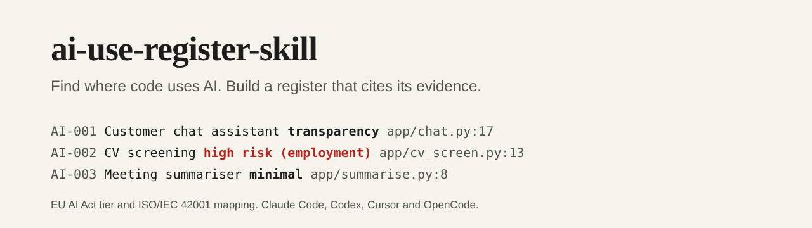

# ai-use-register-skill



[](https://github.com/pJijesh/ai-use-register-skill/actions/workflows/test.yml) [](LICENSE)  

**Problem:** most organisations cannot say where they use AI, who owns it or who it affects. The EU AI Act and ISO/IEC 42001 both start from the same place: a register. Building one by hand from code and interviews is slow, and an AI agent asked to "make an AI register" will happily make one up.

**For:** IT managers, data protection and governance leads who need a first, evidence-backed AI system register for a codebase or an estate, and a working view of EU AI Act risk and ISO/IEC 42001 coverage.

**Demonstrates:** an agent skill that scans code for AI use, interviews the owner for what code cannot show, and writes a register in which every system cites the file and lines that prove it. Zero-dependency scripts check the quotes against the files, validate the logic between fields, and render the register. A worked example for a fictional organisation is included and is verified by the tests.

## What it does

- **A process the agent follows**: scope, scan, group into systems, interview, assess, write, validate, render. See [`SKILL.md`](skills/ai-use-register/SKILL.md).
- **A static scanner** (`scan.mjs`) that finds SDK imports and dependencies, model API endpoints, model names, prompts, tool definitions, key variable names, model files and weak personal-data hints, each with file, line and quote. Output is deterministic.
- **A register format** with owner, purpose, users, models, data, lawful basis, DPIA status, autonomy, human oversight, a working EU AI Act tier with its basis, ISO/IEC 42001 controls and gaps, risks and evidence. The shape is documented in [`register.schema.json`](skills/ai-use-register/schema/register.schema.json).
- **A validator with 24 rules** (18 errors, 6 warnings) that checks enumerations, dates, and the logic a schema cannot: personal data needs a lawful basis; a high-risk tier needs an Annex III area, a human oversight description and a DPIA; `minimal` needs the prohibited-practices and Annex III checks recorded; a prohibited system cannot be in production; evidence quotes must exist in the files at those lines.
- **A report** (`report.mjs`) with a summary table, tier counts, a "needs attention" list and one section per system.
- **Guides** for scanning, interviewing, tiering, mapping to Annex A and recording risks, and a review rhythm.
- **Installers** for Claude Code, Codex, OpenCode and Cursor.

## Install

Requires Node 18 or later. From a clone of this repository:

```bash
node scripts/install.mjs claude            # into the current project
node scripts/install.mjs codex
node scripts/install.mjs opencode
node scripts/install.mjs cursor
node scripts/install.mjs all --dry-run     # show what would be written
node scripts/install.mjs claude --global   # Claude Code, every project
```

| Agent | What is written |
| --- | --- |
| Claude Code | The skill in `.claude/skills/ai-use-register/` (or `~/.claude/skills/` with `--global`) |
| Codex | The skill in `.agents/skills/ai-use-register/` and a marked block in `AGENTS.md` |
| OpenCode | The skill in `.opencode/skills/ai-use-register/` and a marked block in `AGENTS.md` |
| Cursor | A rule in `.cursor/rules/ai-use-register.mdc` and the scripts in `.cursor/ai-use-register/` |

Then ask your agent, for example: "Using the ai-use-register skill, build an AI system register for ./services."

## How it works

```text
scan -> group -> interview -> assess -> register.json -> validate -> REGISTER.md
 |                                           |             |
 ai-usage.json                     cites file:line    quotes checked
 (evidence)                        and quote          against the files
```

The worked example in [`examples/`](examples/) uses [`target-app`](examples/target-app/), a small invented application that has a customer chat assistant, a CV screening tool, a meeting summariser on a local model and a conventional recommender. It is not real and does not run.

```text
$ node skills/ai-use-register/scripts/scan.mjs examples/target-app --out examples/ai-usage.json
$ node skills/ai-use-register/scripts/validate-register.mjs examples/register.json --root examples/target-app --today 2026-11-11
AI-002  REG020  warning  high-risk system acts autonomously; record how human oversight is still effective
AI-004  REG021  warning  review was due 2026-10-01
4 system(s): 0 error(s), 2 warning(s)
```

The scan produced 26 pieces of evidence in 9 files ([`ai-usage.json`](examples/ai-usage.json)). The register ([`register.json`](examples/register.json)) groups them into four systems and the report ([`REGISTER.md`](examples/REGISTER.md)) shows what needs attention: the CV screening tool is assessed as high-risk (employment) with a DPIA not yet started and no evidence of human review, and the chatbot shows no sign that customers are told it is AI. The two warnings are left in the example on purpose, to show what the validator is for.

## How it is built

```text
.
├── skills/ai-use-register/
│   ├── SKILL.md                  The process and ground rules
│   ├── core.md                   Condensed text for AGENTS.md and Cursor
│   ├── references/               scanning, interview, tiering, iso42001, risks, review
│   ├── schema/                   register.schema.json (documents the shape)
│   └── scripts/                  scan, validate-register, report, lib, rules, signatures, controls
├── scripts/                      install.mjs and build.mjs (generates the adapters)
├── adapters/                     Generated AGENTS.md block and Cursor rule
├── examples/                     target-app, ai-usage.json, register.json, REGISTER.md
├── test/                         node:test suites
└── .github/workflows/test.yml
```

## Design choices

- **The code answers part; people answer the rest.** The scanner finds what is in the files. The interview covers owner, purpose, users, oversight and contracts, and anything unknown is recorded as a gap, not guessed.
- **Evidence is checkable.** Each system cites quotes that a script finds in the files, so a register cannot quietly describe code that is not there.
- **A tier is a working assessment.** The skill never concludes `minimal` without recording the prohibited-practices and Annex III checks, and prefers `needs_assessment` when unsure.
- **Gaps are first-class.** The register records where a control or a safeguard should exist and does not.
- **Static and read-only.** Nothing is run, no vendor API is called, no real data is opened.
- **Deterministic and dependency-free**, so the register can live in version control and be diffed.

## Limitations

- **Not legal advice.** Tiers are working assessments to review with a data protection or legal adviser. The Act and its application dates change; the skill tells the agent to check current text.
- **A code scan misses a lot.** AI built into bought software, browser tools and spreadsheets does not appear, and neither does anything outside the folder. The register covers what was scanned, and says so.
- **Signatures are heuristics.** Model names, SDKs and endpoints are matched by pattern. New or unusual libraries are missed, and a dependency is not proof of use. Data hints are weak signals.
- **The validator checks consistency, not correctness.** A well-formed register can still contain a wrong tier.
- **ISO/IEC 42001 mapping is orientation.** Control titles here are short paraphrases. Mapping a control does not mean the organisation conforms to the standard.
- **The example is small and constructed.** It was written to show every tier and several gaps; it says nothing about how an agent performs on a large real codebase.
- **The installer paths follow each tool's documentation as I understand it.** They have not been tested inside Claude Code, Codex, OpenCode or Cursor themselves.

## Verification status

- The tests cover the scanner (known evidence, determinism, that every quote is on its line, skipped folders, path-only model files, data hints), each of the 24 validator rules and the exit codes of the command line, the report's determinism and match with the committed file, that the schema, enums and documented controls agree, each installer in a temporary directory, that generated files are current, and repository hygiene.
- Every example evidence quote was checked by the validator against the fictional application.
- It was run on Node 22 here. The CI workflow covers Node 18, 20 and 22.
- The skill has not been tested with a real agent on a real codebase, so there is no claim about how complete its registers are.

## Roadmap

Planned, not promised.

- **Next:** Run it with each of the four agents on a few open-source projects and record what the scanner misses
- **Then:** Signatures for more SDKs and for infrastructure files that provision model endpoints
- **Later:** An optional comparison of two scans to show what changed since the last review

## Related work

The [eu-ai-act-risk-classifier](https://github.com/pJijesh/eu-ai-act-risk-classifier) answers the tier question one system at a time, and the [eu-ai-act-tracker](https://github.com/pJijesh/eu-ai-act-tracker) lists the dates. This repository is the inventory that feeds them. It shares no code with other projects.

## Licence

[MIT](LICENSE), 2026 Puliyappottammal Jijesh. See [CONTRIBUTING](CONTRIBUTING.md) for how to suggest a change.

Built by [Puliyappottammal Jijesh](https://www.linkedin.com/in/pjijesh), an IT manager. [GitHub](https://github.com/pJijesh)
